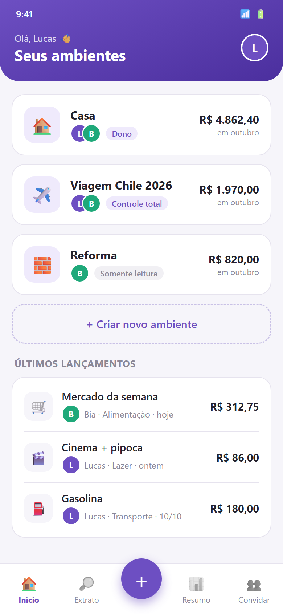
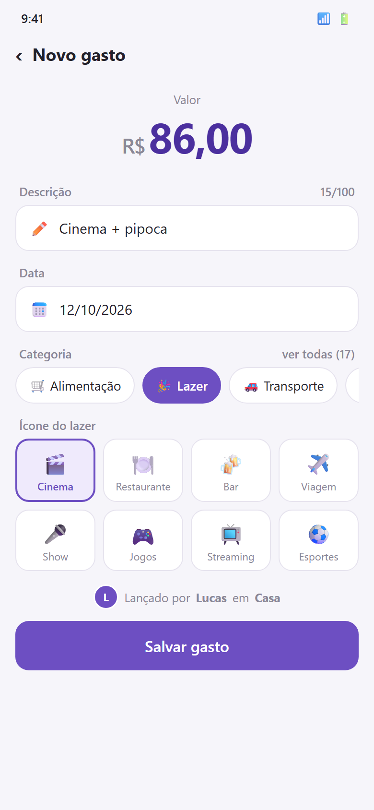
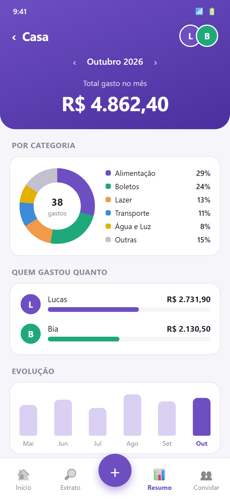
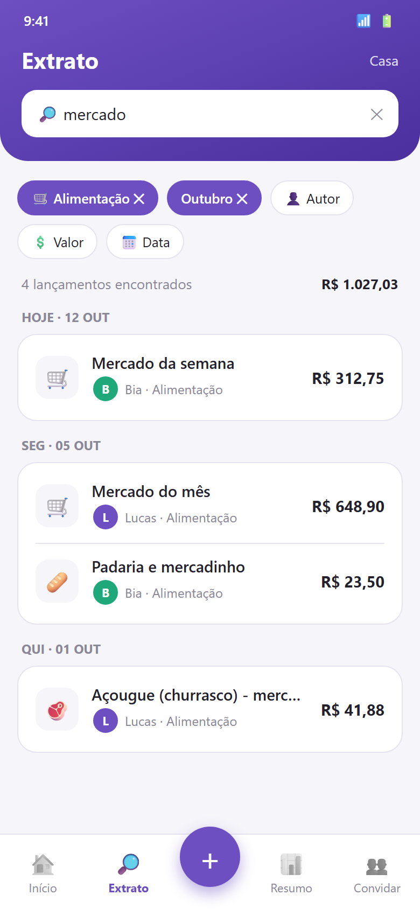
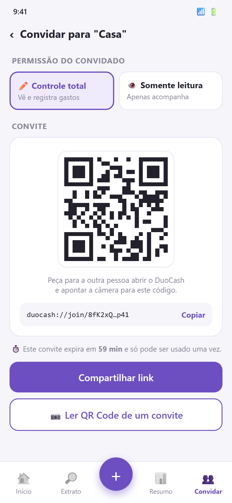

# 💑 DuoCash

Aplicativo de controle financeiro para casais. Os dois registram os gastos no mesmo lugar e acompanham juntos para onde o dinheiro do mês está indo.

> Projeto da disciplina de Engenharia de Software. O repositório tem a documentação, o protótipo, o aplicativo Android (`mobile/`) e a API (`backend/`).

📲 **Instalar:** baixe o `DuoCash.apk` da [última versão](https://github.com/PAJEGUES/duo-cash/releases/latest). O passo a passo completo (servidor, login Google e instalação) está em [docs/deploy.md](docs/deploy.md).

## 📌 Sobre o Projeto

Quem divide as contas com outra pessoa normalmente controla tudo em planilha, em mensagem de WhatsApp ou de cabeça. Com o tempo ninguém sabe mais quanto foi gasto nem quem pagou o quê.

A ideia do **DuoCash** é ser uma "planilha viva" do casal dentro do celular:

- um dos dois cria um **ambiente** (por exemplo "Casa" ou "Viagem") e convida o outro por **link** ou **QR Code**;
- cada um lança os seus gastos manualmente, com valor, data, descrição e categoria;
- todo lançamento fica marcado com o nome de quem registrou;
- o app soma tudo sozinho e mostra o resumo do mês por categoria e por pessoa.

O app não se conecta com banco nenhum. O registro é 100% manual, que é justamente o que faz o casal prestar atenção no que está gastando.

### Princípios do produto

| Princípio | Na prática |
|---|---|
| Registrar em menos de 10 segundos | Lançamento em uma única tela, começando pelo valor |
| Transparência entre o casal | Todo gasto mostra quem registrou |
| Sem integração bancária | Nada de Open Finance, tudo é digitado pelo usuário |
| Privacidade | Só entra no ambiente quem recebeu convite |
| Funcionar com internet ruim | Cache local e nova tentativa automática de envio |

### Principais funcionalidades

- 🔐 **Login com conta Google**, sem cadastro de senha no app
- 📊 **Ambientes compartilhados**, podendo ter mais de um (Casa, Viagem, Reforma...)
- 📷 **Convite por link ou QR Code**, com permissão de *controle total* ou *somente leitura*
- 💸 **Registro de gastos** com 17 categorias fixas
- 🎨 **Ícones para gastos de lazer** (cinema, restaurante, viagem, show...)
- 📈 **Resumo mensal** com gráfico por categoria e comparativo de quem gastou quanto
- 🔎 **Busca** por descrição, valor, data, categoria e autor

Os requisitos completos estão em [docs/requisitos.md](docs/requisitos.md).

## 🛠️ Tecnologias, Ferramentas e Infraestrutura

### Mobile


### Backend


### Banco de dados


### Infraestrutura e ferramentas


| Camada | Tecnologia | Para que serve |
|---|---|---|
| App | React Native + Expo | Base do aplicativo Android |
| App | TypeScript | Linguagem do app |
| App | NativeWind (Tailwind CSS) | Estilo das telas, com modo escuro automático |
| App | Reanimated + Expo Haptics | Animações de entrada e micro-interações |
| App | TanStack Query | Cache dos dados e nova tentativa quando a internet cai |
| App | expo-camera | Leitura do QR Code do convite |
| App | expo-secure-store | Guardar os tokens de login com segurança |
| API | Python 3.11 + Flask | API REST |
| API | SQLAlchemy + Alembic | Acesso ao banco e controle de versão das tabelas |
| API | PyJWT + google-auth | Tokens de sessão e validação do login Google |
| Banco | PostgreSQL 15 | Banco de dados relacional |
| Login | Google OAuth 2.0 | Autenticação com a conta Google |
| Infra | Docker + Docker Compose | Subir API e banco do mesmo jeito em qualquer máquina |
| Infra | Render (plano Free) | Hospedagem da API com HTTPS e deploy automático, sem custo |
| Infra | Neon (plano Free) | PostgreSQL gerenciado, sem custo |
| Infra | Caddy + Let's Encrypt | Opcional: HTTPS numa VM própria (`deploy/`) |
| Infra | Gradle (build local) + GitHub Releases | Gerar e distribuir o APK assinado |
| Infra | GitHub Actions | Rodar os testes a cada push e pull request |
| Testes | PyTest e Jest | Testes da API e do app |
| Segurança | Bandit, pip-audit, npm audit, Ruff | Análise estática e dependências vulneráveis |
| Design | HTML + CSS | Protótipo das telas |

O aplicativo **não vai para a Play Store**. Como é para uso do casal, a instalação é feita direto pelo arquivo APK.

Mais detalhes em [docs/arquitetura.md](docs/arquitetura.md).

## 🔁 Metodologias utilizadas

### Modelo de processo: incremental com Scrum

Para escolher o modelo comparei os que vimos em aula:

| Modelo | Como funciona | Serve para o DuoCash? |
|---|---|---|
| **Cascata** | Uma fase depois da outra (requisitos, projeto, implementação, testes, manutenção). Voltar atrás custa caro. | ❌ Só daria para usar o app no final. Se o casal não gostar do jeito de lançar gasto, o problema só aparece depois de tudo pronto. |
| **Espiral** | Ciclos com análise de risco em cada volta. Indicado para sistemas grandes e de alto risco. | ❌ É pesado demais para um projeto pequeno. A análise de risco formal em cada ciclo daria mais trabalho do que o próprio app. |
| **Incremental / Ágil (Scrum)** | O sistema é entregue em partes pequenas que já funcionam, com feedback a cada entrega. | ✅ Dá para usar o app desde a primeira entrega e ir ajustando. |

**Por que incremental?** Os requisitos do DuoCash ainda vão mudar bastante. Coisas como as categorias, o formato do resumo e o fluxo de convite só dá para saber se estão boas usando no dia a dia. Entregando em partes, a primeira versão já serve para registrar gastos e as próximas vão acrescentando o resto.

Do **Scrum** vou usar:

- **Product Backlog**: os requisitos de [docs/requisitos.md](docs/requisitos.md) viram issues no GitHub, em ordem de prioridade;
- **Sprints de 2 semanas**, cada uma terminando com algo que funciona;
- **Revisão no fim da sprint**: testar a entrega no celular e anotar o que precisa mudar;
- **Kanban** no GitHub Projects com as colunas *A fazer*, *Fazendo*, *Em revisão* e *Feito*.

### Planejamento das entregas

| Sprint | Entrega | Requisitos |
|---|---|---|
| 1 | Projeto configurado, login com Google e criação de ambiente | RF01, RF02 |
| 2 | Registro e listagem de gastos | RF06, RF07, RF09 |
| 3 | Convite por link e QR Code, com permissões | RF03, RF04, RF05, RF13 |
| 4 | Resumo mensal com gráficos | RF10, RF11 |
| 5 | Busca com filtros e ícones de lazer | RF08, RF12 |
| 6 | Gestão do ambiente, testes finais e geração do APK | RF14 |

A partir da sprint 2 já existe um app que pode ser usado de verdade, mesmo que só por uma pessoa.

### Como o Git e o GitHub são usados

**Branches**

```
main                    versão estável, só recebe código revisado
└── develop             junta o que foi feito na sprint
    ├── feature/login-google
    ├── feature/registro-gasto
    └── fix/soma-resumo-mensal
```

- Cada tarefa do Kanban vira uma branch `feature/...` (ou `fix/...` para correção) criada a partir da `develop`.
- Quando a tarefa termina, abre-se um **Pull Request** para a `develop`. O GitHub Actions roda os testes e só entra se passar.
- No fim da sprint a `develop` vai para a `main` e a versão ganha uma **tag** (`v0.1.0`, `v0.2.0`...).

A primeira versão (v0.1.0) entrou direto na `main`. Daqui em diante as mudanças seguem o fluxo de branches acima.

**Commits**

Os commits seguem o padrão [Conventional Commits](https://www.conventionalcommits.org/pt-br/), pequenos e com mensagem dizendo o que mudou:

| Prefixo | Quando usar |
|---|---|
| `feat:` | Nova funcionalidade |
| `fix:` | Correção de erro |
| `docs:` | Documentação |
| `test:` | Testes |
| `refactor:` | Melhoria no código sem mudar o comportamento |
| `chore:` | Configuração e dependências |

```
feat(gastos): adiciona seletor de ícones para a categoria Lazer
fix(resumo): corrige soma do mês quando o gasto é excluído
docs: atualiza diagrama de caso de uso
```

**Outros recursos do GitHub**

- **Issues** para o backlog e para registrar erros;
- **GitHub Projects** para o quadro Kanban;
- **GitHub Actions** para rodar os testes automaticamente;
- **.gitignore** para não subir senhas, arquivos `.env` e o APK gerado.

### Testes

| Tipo | Ferramenta | O que verifica |
|---|---|---|
| Unitário (API) | PyTest | Soma do mês, conversão para centavos, regras de permissão |
| Unitário (app) | Jest | Formatação de moeda, limite de 100 caracteres |
| Integração | PyTest + banco de teste | Login, criar gasto, aceitar convite |
| Manual | No celular | Duplo toque em salvar, modo avião, troca de tela durante o envio |

## 🎨 Projeto de Interface

As telas foram montadas em HTML e CSS, no tamanho de um celular. O protótipo está na pasta [prototipo/](prototipo/) e dá para navegar entre as telas: é só baixar o repositório e abrir o arquivo `prototipo/index.html` no navegador.

| Login | Ambientes | Novo gasto |
|:---:|:---:|:---:|
|  |  |  |
| Entrada somente com a conta Google | Lista dos ambientes e últimos lançamentos | Valor, descrição, data, categoria e ícone de lazer |

| Resumo do mês | Extrato e busca | Convite por QR Code |
|:---:|:---:|:---:|
|  |  |  |
| Total, gráfico por categoria e quem gastou quanto | Busca por descrição com filtros | Escolha da permissão, QR Code e link |

**Sobre o visual**

- Roxo como cor principal e verde para diferenciar a segunda pessoa do casal;
- Cada pessoa tem uma cor e a inicial do nome, e isso aparece em todo lançamento;
- Botão **+** sempre no centro do menu, porque registrar gasto é a ação mais usada;
- Na tela de novo gasto o valor vem primeiro e em destaque, para o registro ser rápido.

## 📐 Diagramas

- [Diagrama de caso de uso](docs/diagramas/caso-de-uso.md)
- [Diagramas de sequência](docs/diagramas/sequencia.md) (login, convite e registro de gasto)
- [Arquitetura e modelo de dados](docs/arquitetura.md)
- [Implantação e instalação](docs/deploy.md)
- [Plano de testes 360°](docs/testes.md)

## 🗺️ Próximos passos

- [x] Levantamento de requisitos
- [x] Protótipo das telas
- [x] Diagramas
- [x] Sprint 1: login com Google e criação de ambiente
- [x] Sprint 2: registro de gastos
- [x] Sprint 3: convite por QR Code
- [x] Sprint 4: resumo mensal
- [x] Sprint 5: busca e ícones de lazer
- [x] Sprint 6: testes e APK (v0.1.0)
- [ ] Validação com o casal no dia a dia (UAT) e ajustes
- [ ] Testes E2E automatizados (Maestro) e varredura OWASP ZAP

Ideias para versões futuras: foto do comprovante, orçamento por categoria, gastos recorrentes e exportação em PDF.

---

Desenvolvido por **José Marin** 💜
