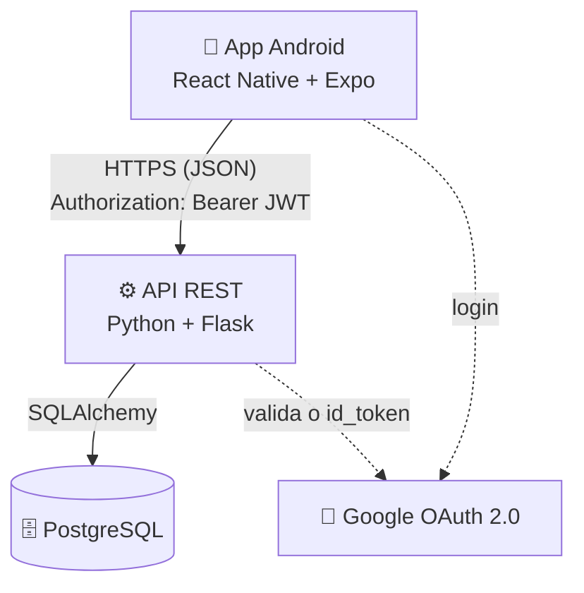
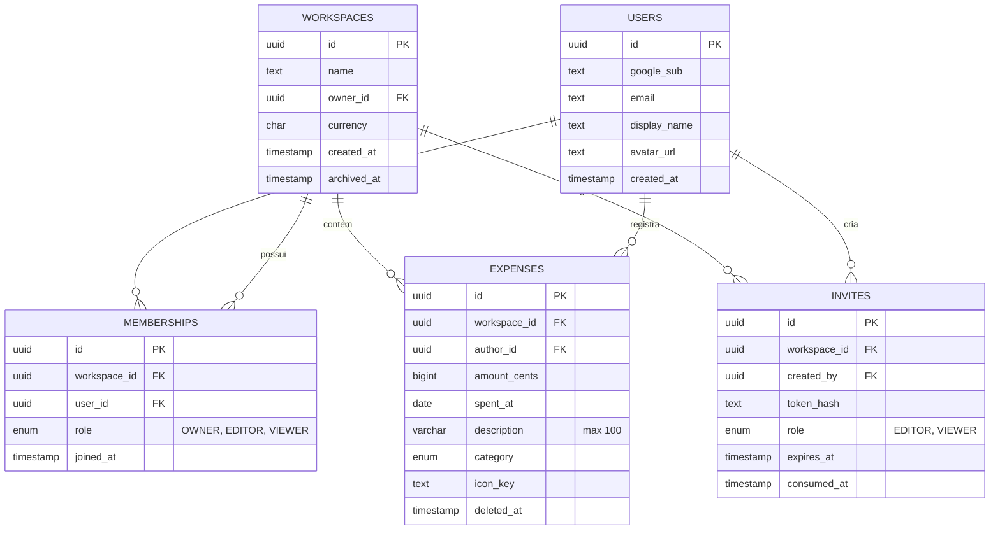

# Arquitetura do DuoCash

## Visão geral

O sistema é dividido em três partes: o aplicativo no celular, uma API no servidor e o banco de dados.



| Parte | Responsabilidade |
|---|---|
| App | Telas, validação dos formulários, cache dos dados e leitura do QR Code |
| API | Regras de negócio, autenticação, permissões e cálculo dos resumos |
| Banco | Guardar usuários, ambientes, convites e gastos |

## Decisões importantes

- **O servidor é quem manda.** O app nunca informa quem é o autor do gasto nem qual é a permissão do usuário. Essas duas informações saem do token validado na API.
- **Dinheiro em centavos.** R$ 1.234,56 é salvo como `123456` (inteiro). Usar número com vírgula (`float`) para dinheiro dá erro de arredondamento.
- **Exclusão lógica.** Quando um gasto é excluído ele só é marcado como excluído, assim o histórico do casal não se perde.
- **Sem gasto duplicado.** O app manda um identificador único em cada lançamento (`Idempotency-Key`). Se o usuário tocar duas vezes em salvar, o servidor ignora a segunda.
- **Fora da Play Store.** O app é instalado por APK gerado no Expo EAS. Mudanças só de tela e texto são enviadas por atualização OTA (EAS Update), sem precisar instalar de novo.

## Modelo de dados



No código as tabelas ficam em inglês: `workspaces` são os ambientes, `memberships` é o vínculo do usuário com o ambiente, `invites` os convites e `expenses` os gastos.

## Principais rotas da API

Base: `/api/v1`

| Método | Rota | O que faz |
|---|---|---|
| POST | `/auth/google` | Troca o token do Google pelos tokens do app |
| POST | `/auth/refresh` | Renova a sessão |
| GET | `/workspaces` | Lista os ambientes do usuário |
| POST | `/workspaces` | Cria um ambiente (quem cria vira dono) |
| GET | `/workspaces/{id}/members` | Lista os membros |
| POST | `/workspaces/{id}/invites` | Gera convite (link + QR Code) |
| POST | `/invites/{token}/accept` | Aceita o convite |
| GET | `/workspaces/{id}/expenses` | Lista os gastos, com filtros de busca |
| POST | `/workspaces/{id}/expenses` | Registra um gasto |
| PATCH | `/expenses/{id}` | Edita um gasto |
| DELETE | `/expenses/{id}` | Exclui um gasto (exclusão lógica) |
| GET | `/workspaces/{id}/summary?month=2026-10` | Resumo do mês por categoria e por autor |

Filtros da busca: `q` (descrição), `category`, `author_id`, `date_from`, `date_to`, `amount_min` e `amount_max`.

## Segurança

- Login só pelo Google. O app não tem senha própria e não guarda a senha de ninguém.
- Token de acesso com duração curta (15 min) e token de renovação de 30 dias.
- Tokens guardados no `expo-secure-store` (cofre do Android), nunca em armazenamento comum.
- Toda rota confere se o usuário é membro do ambiente e se a permissão dele deixa fazer a ação.
- O convite é de uso único, expira, e no banco fica só o hash do token.
- Limite de requisições nas rotas de login e de convite.
- Mensagens de erro nunca mostram detalhes internos do servidor.

## Estrutura de pastas planejada

```
duo-cash/
├── mobile/            # app React Native (Expo)
│   ├── app/           # rotas das telas (Expo Router)
│   └── src/           # componentes, hooks, constantes
├── backend/           # API Flask
│   ├── app/           # rotas, modelos, regras de negócio
│   ├── migrations/    # versões do banco (Alembic)
│   └── tests/
├── docs/              # documentação e diagramas
├── prototipo/         # protótipo das telas em HTML/CSS
└── README.md
```

As pastas `mobile/` e `backend/` ainda não existem, entram quando o desenvolvimento começar.
