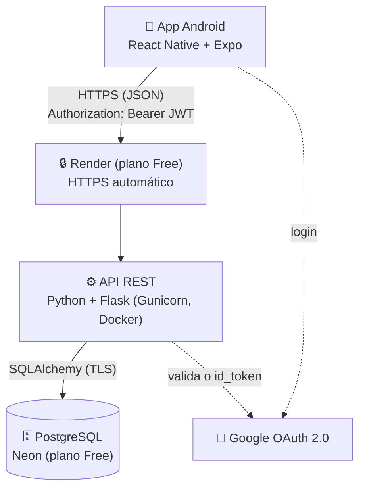
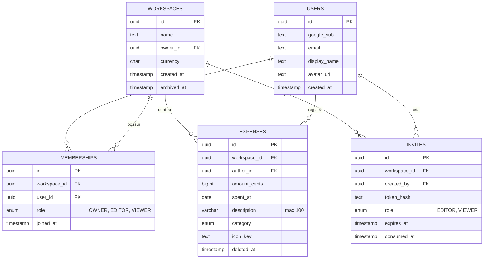

# Arquitetura do DuoCash

## Visão geral

O sistema é dividido em três partes: o aplicativo no celular, uma API no servidor e o banco de dados.



| Parte | Responsabilidade |
|---|---|
| App | Telas, validação dos formulários, cache dos dados e leitura do QR Code |
| API | Regras de negócio, autenticação, permissões e cálculo dos resumos |
| Banco | Guardar usuários, ambientes, convites e gastos |

## Decisões importantes

- **O servidor é quem manda.** O app nunca informa quem é o autor do gasto nem qual é a permissão do usuário. Essas duas informações saem do token validado na API.
- **Dinheiro em centavos.** R$ 1.234,56 é salvo como `123456` (inteiro). Usar número com vírgula (`float`) para dinheiro dá erro de arredondamento.
- **Exclusão lógica.** Quando um gasto é excluído ele só é marcado como excluído, assim o histórico do casal não se perde.
- **Sem gasto duplicado.** O app manda um identificador único em cada lançamento (`Idempotency-Key`). Se o usuário tocar duas vezes em salvar, o servidor ignora a segunda.
- **Fora da Play Store.** O app é instalado por APK assinado, gerado localmente (`mobile/scripts/build-apk.ps1`) e publicado nas *Releases* do GitHub. Cada nova versão é instalada por cima da anterior, sem perder dados (eles ficam no servidor).
- **Endereço do servidor configurável.** O APK não depende de um IP fixo: na primeira abertura o usuário informa o endereço `https://` do servidor. Só `https` é aceito na versão de produção.
- **Client ID do Google vem do servidor.** O app busca em `GET /config` o ID do cliente OAuth, então trocar a configuração do Google não exige um APK novo.
- **Cor de cada pessoa.** A API devolve os membros sempre na ordem de entrada no ambiente; o app usa essa ordem para as cores (dono roxo, parceiro(a) verde).
- **Hospedagem gratuita e permanente.** A API roda no plano Free do Render (container Docker, HTTPS e deploy automático a cada push) e o banco no plano Free do Neon (PostgreSQL). Nenhum dos dois pede cartão, então não há cobrança depois de um período de teste. O preço disso é o "cochilo": sem uso por 15 min o servidor dorme e a primeira requisição leva até ~1 min, por isso o app espera até 75 s por resposta. Para quem preferir uma VM própria, `deploy/` traz Docker Compose com PostgreSQL e Caddy (HTTPS automático via `<ip>.sslip.io`).
- **Login com Google independente da hospedagem.** O app pega o `id_token` com o Google e a API valida assinatura, emissor e audiência. Os IDs OAuth são criados pelo Firebase (plano gratuito Spark), sem cartão nem faturamento.

## Modelo de dados



No código as tabelas ficam em inglês: `workspaces` são os ambientes, `memberships` é o vínculo do usuário com o ambiente, `invites` os convites e `expenses` os gastos.

## Principais rotas da API

Base: `/api/v1`

| Método | Rota | O que faz |
|---|---|---|
| GET | `/config` | Configuração pública (client ID Web do Google, categorias) |
| POST | `/auth/google` | Troca o token do Google pelos tokens do app |
| POST | `/auth/refresh` | Renova a sessão |
| GET | `/me` | Dados do usuário logado |
| GET | `/workspaces` | Lista os ambientes do usuário |
| POST | `/workspaces` | Cria um ambiente (quem cria vira dono) |
| GET / PATCH / DELETE | `/workspaces/{id}` | Detalhe, renomear/arquivar e excluir (exclusão lógica) |
| GET | `/workspaces/{id}/members` | Lista os membros |
| DELETE | `/workspaces/{id}/members/{user_id}` | Remove o acesso de um membro (dono) |
| POST | `/workspaces/{id}/leave` | Sai do ambiente (quem não é dono) |
| POST / GET | `/workspaces/{id}/invites` | Gera convite (link + QR Code) / lista os pendentes |
| DELETE | `/invites/{invite_id}` | Cancela um convite |
| GET | `/invites/{token}` | Mostra de quem é o convite antes de aceitar |
| POST | `/invites/{token}/accept` | Aceita o convite |
| GET | `/workspaces/{id}/expenses` | Lista os gastos, com filtros de busca |
| POST | `/workspaces/{id}/expenses` | Registra um gasto |
| PATCH | `/expenses/{id}` | Edita um gasto |
| DELETE | `/expenses/{id}` | Exclui um gasto (exclusão lógica) |
| GET | `/workspaces/{id}/summary?month=2026-10` | Resumo do mês por categoria e por autor |

Fora do prefixo `/api/v1` existe ainda `GET /convite/{token}`, uma página simples que abre o app pelo link `duocash://join/{token}` (é o link enviado pelo WhatsApp).

Filtros da busca: `q` (descrição), `category`, `author_id`, `date_from`, `date_to`, `amount_min` e `amount_max`.

## Segurança

- Login só pelo Google. O app não tem senha própria e não guarda a senha de ninguém. A API confere emissor, audiência e e-mail verificado do token do Google.
- Token de acesso com duração curta (15 min) e token de renovação de 30 dias, assinados com algoritmo fixo e com tipo, emissor e audiência obrigatórios.
- Tokens guardados no `expo-secure-store` (cofre do Android), nunca em armazenamento comum. Backup do app desligado.
- Toda rota confere se o usuário é membro do ambiente e se a permissão dele deixa fazer a ação. Quem não é membro recebe 404 (não dá nem para saber se o ambiente existe).
- O convite é de uso único, expira, e no banco fica só o hash do token. A aceitação é atômica: dois aceites simultâneos não usam o mesmo convite.
- Limite de requisições nas rotas de login e de convite.
- Mensagens de erro nunca mostram detalhes internos do servidor.
- Cabeçalhos de segurança (HSTS, `nosniff`, `X-Frame-Options`, CSP) e sem CORS, porque só o app nativo usa a API.
- Log de eventos de segurança (login, convites, remoção de membro, acesso negado) só com identificadores, sem e-mail, token, valor ou descrição.
- Container da API sem root; conexão com o banco sempre por TLS (`sslmode=require`).
- Segredos só no painel do Render (ou no `deploy/.env` de uma VM própria) e na máquina de build, nunca no repositório. A `SECRET_KEY` é gerada pelo Render.

Detalhes de implantação em [deploy.md](deploy.md) e o plano de testes em [testes.md](testes.md).

## Estrutura de pastas

```
duo-cash/
├── mobile/              # app React Native (Expo SDK 58 + TypeScript)
│   ├── src/app/         # telas (Expo Router)
│   ├── src/api/         # cliente HTTP, tipos e hooks do TanStack Query
│   ├── src/components/  # componentes visuais (NativeWind/Tailwind)
│   ├── src/lib/         # regras puras: dinheiro, datas, validação (com testes Jest)
│   └── scripts/         # geração do APK
├── backend/             # API Flask
│   ├── app/             # rotas (blueprints), modelos, regras de negócio
│   ├── migrations/      # versões do banco (Alembic)
│   └── tests/           # PyTest + teste de estresse
├── render.yaml          # Blueprint do Render (API no plano gratuito)
├── deploy/              # alternativa: Docker Compose para VM própria (Postgres + Caddy)
├── .github/workflows/   # CI do app e da API
├── docs/                # documentação e diagramas
└── prototipo/           # protótipo das telas em HTML/CSS
```
