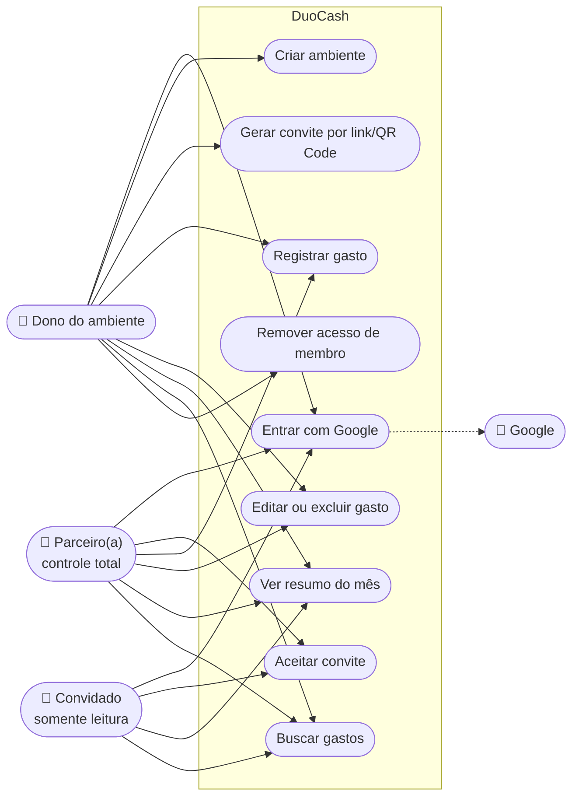

# Diagrama de Caso de Uso

## Descrição resumida

| Caso de uso | Ator | Descrição |
|---|---|---|
| Entrar com Google | Todos | O usuário se autentica com a conta Google. Sem login não acessa nada. |
| Criar ambiente | Dono | Cria um espaço de gastos (ex.: "Casa") e passa a ser o dono dele. |
| Gerar convite | Dono | Escolhe a permissão e o app mostra o QR Code e o link do convite. |
| Aceitar convite | Parceiro(a) / Convidado | Lê o QR Code ou abre o link e entra no ambiente. |
| Registrar gasto | Dono / Parceiro(a) | Informa valor, data, descrição e categoria. |
| Editar ou excluir gasto | Dono / Parceiro(a) | Corrige ou remove um lançamento. |
| Ver resumo do mês | Todos | Vê o total, o gráfico por categoria e quanto cada um gastou. |
| Buscar gastos | Todos | Filtra o extrato por descrição, valor, data, categoria ou autor. |
| Remover acesso de membro | Dono | Tira uma pessoa do ambiente. |
